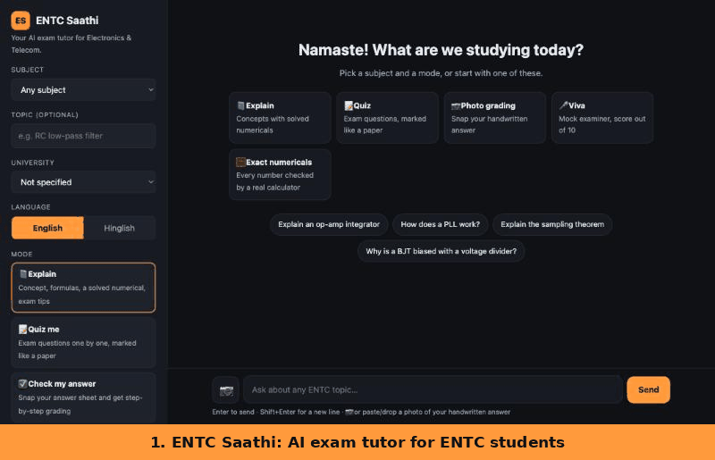
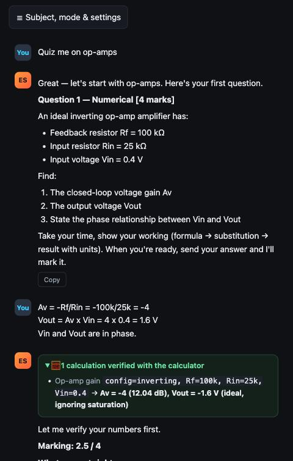

# ENTC Saathi 📡

**An AI exam tutor for Electronics & Telecommunication (ENTC / ECE) students. Snap a photo of your handwritten answer and get it graded like a university examiner would.**

Powered by the **BharatCode model API** · Built for the **BharatCode Build League**

### 👉 [Try it live: entc-saathi.onrender.com](https://entc-saathi.onrender.com)

*Free hosting: the first visit after a quiet spell can take about 30–50 s to wake up. At busy times BharatCode may queue requests, and the app shows when that's happening.*

---

<p align="center"></p>

*Recorded on the live app with the real BharatCode model. The answer sheet has a deliberate 10× slip (fc = 33.9 kHz instead of 3.386 kHz), and ENTC Saathi catches it, gives 3 / 4 with method marks, and suggests a cross-check. The queue wait is sped up in the GIF. (The demo sheet is a generated handwriting-style image.)*

<details><summary>More: quiz mode marking an op-amp answer</summary>

<p align="center"></p>

*The student dropped a minus sign and got the phase wrong. The numbers were verified and the answer marked 2.5 / 4.*
</details>

## Why

Most AI study tools are built for CS students. ENTC students work with circuits, signals, communication systems and microcontrollers, and they study for exams that are mostly **handwritten numericals and vivas**. Generic chatbots don't mark the way examiners do, and they can't see your answer sheet.

ENTC Saathi is built for how ENTC students actually study.

## Features

| | Feature | What it does |
|---|---|---|
| 🧮 | **Exact numericals** | Language models are bad at arithmetic. ENTC Saathi never lets the model guess a number: every value is computed by a real calculator, a student's numbers are checked automatically (✅/❌ with the correct value), and every verified calculation is shown. |
| 📷 | **Photo grading** | Snap or paste a photo of your handwritten working. You get a score, line-by-line ✅/❌ marking, the corrected solution and a tip. |
| 📘 | **Explain** | Intuition → key formulas → a solved exam-style numerical → common mistakes → likely exam questions |
| 📝 | **Quiz me** | One question at a time with marks. It grades your answer (typed or photographed) and the difficulty adapts to you. |
| 🎤 | **Viva practice** | A mock external examiner asks 6 probing questions about your lab experiment, then scores you out of 10 |
| 🎓 | **University-aware** | Pick SPPU, Mumbai University, VTU, AKTU, GTU, Anna University and more to match the exam style |
| 🗣️ | **Hinglish mode** | Explanations in the way students actually talk, with technical terms kept in English |
| ⚡ | **Streaming answers** | Text appears as it is written, so there's no waiting on a spinner |
| 💾 | **Remembers your session** | Refreshing the page doesn't lose your conversation |

13 subjects: Network Theory, Analog Circuits, Digital Electronics, Signals & Systems, Control Systems, Microcontrollers (8051/ARM), Analog & Digital Communication, Electromagnetics & Antennas, DSP, VLSI, Embedded Systems, Power Electronics and Computer Networks.

## How it works

```
Browser (index.html)          Node server (server.js)                   BharatCode API
 • chat UI, modes, settings ─▶ • builds the tutor prompt              ─▶ qwen-3.8-27b
 • photo resize (≤1600px)      • ONE streamed model call per answer      /chat/completions
 • shows verified calcs     ◀─ • model writes [[calc: …]] / [[check: …]] (stream, image input)
                                 tags; tools.js evaluates them exactly
                                 as the text streams and swaps in values
                               • keeps the API key on the server
                               • shows queue status, retries on 503
```

- Uses BharatCode's OpenAI-compatible `/chat/completions` endpoint with **streaming** and **image input**.
- **Exact numbers in a single model call.** The model never does arithmetic. It writes tags like `[[calc: 1/(2*pi*4.7k*10n) | Hz]]` and the server evaluates them with a safe parser (no `eval`) as the answer streams in. `[[check: 33.9k | … | Hz]]` compares a student's number with the exact value (2 % tolerance) and shows ✅ or ❌ with the correct value.
- **Why tags and not function calling?** Function calling needs a second model call after every calculation, and on a shared, queued API that doubled the wait. Tags give the same exactness with one call. Classic tool calling with 8 ENTC formula tools is still built in (`TOOL_MODE=api`).
- Unit tests: `node --test`
- **Zero dependencies.** It only needs Node.js 18 or newer, with no `npm install`.
- The API key never reaches the browser. Photos are resized in the browser and only the latest one is sent, so requests stay small.

## Run it locally

1. Install [Node.js](https://nodejs.org) 18 or newer.
2. Get your developer API key from https://bharatcode.ai/account (API access needs Lite, Pro or verified student access).
3. In this folder, copy `.env.example` to `.env` and put in your key:
   ```
   BHARATCODE_API_KEY=bc_live_your_key_here
   ```
4. Start it:
   ```
   node server.js
   ```
5. Open http://localhost:3000

Optional settings (in `.env`): `PORT`, `BHARATCODE_MODEL` (default `qwen-3.8-27b`), `DEMO_MODE=1` (UI only, no API calls).

## Deploy (free)

The repo includes `render.yaml`. On [Render](https://render.com), choose **New → Blueprint**, pick this repo and paste your `BHARATCODE_API_KEY` when asked. Any Node host works: start command `node server.js`, health check `/healthz`.

## Project files

| File | Purpose |
|---|---|
| `server.js` | HTTP server, tutor prompts, streaming BharatCode API call with the tool loop |
| `tools.js` | Safe expression evaluator, inline `[[calc]]`/`[[check]]` tags and the function-calling tools |
| `test/tools.test.js` | Unit tests for every tool (`node --test`) |
| `index.html` | The whole web UI (chat, photo upload, modes, Markdown rendering) |
| `render.yaml` | One-click deploy config |
| `BharatCode.txt` | Hackathon entry marker |

## Roadmap

- Track weak topics across sessions and suggest revision
- Previous-year question paper practice per university
- Circuit diagram → explanation (draw a circuit, get its analysis)

## Disclaimer

AI answers can be wrong. Always cross-check with your textbook and faculty.

## License

MIT © Pranjal Panwar
